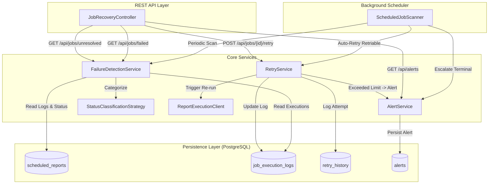

# Meridian Payments – Failed Scheduled Report Recovery Service

[](https://www.oracle.com/java/)
[](https://spring.io/projects/spring-boot)
[](https://www.postgresql.org/)
[]()

Enterprise-grade, resilient Spring Boot 3 microservice for **Meridian Payments** that automatically scans scheduled financial report execution logs, identifies failed jobs, classifies disparate execution statuses and error codes, recovers safe retriable failures with a bounded retry policy (max 3 attempts), generates alerts for unrecoverable failures, and exposes operational REST APIs with Micrometer metrics and audit logging.

---

## Table of Contents

- [Overview](#overview)
- [Key Features](#key-features)
- [Architecture & Workflow](#architecture--workflow)
- [Domain & Data Model](#domain--data-model)
- [Classification Strategy](#classification-strategy)
- [REST API Reference](#rest-api-reference)
- [Configuration](#configuration)
- [Getting Started](#getting-started)
- [Testing & Quality Assurance](#testing--quality-assurance)
- [Observability & Metrics](#observability--metrics)

---

## Overview

Meridian Payments generates periodic financial statements and reports for business customers. When downstream services, network timeouts, or report generators fail, jobs can be left in an incomplete state. 

This recovery service provides:
1. **Automated Health Evaluation**: Scans report schedules and determines overall health. If a schedule has at least one successful execution, it is considered healthy (even if an earlier run timed out).
2. **Intelligent Failure Categorization**: Distinguishes transient failures (e.g., `TIMEOUT`, `NETWORK_ERROR`) from terminal failures (e.g., `REPORT_NOT_FOUND`, `PERMISSION_DENIED`).
3. **Bounded Retries**: Automatically retries safe failures up to **3 attempts**, maintaining an immutable audit history in `retry_history`.
4. **Alerting & Escalation**: Raises alerts immediately on terminal failures or once retry limits are exhausted.

---

## Key Features

- **Spring Boot 3.3.4 & Java 21**: Modern platform leveraging records, pattern matching, and virtual-thread compatibility.
- **Strategy Pattern for Error Classification**: Decoupled, pluggable `StatusClassificationStrategy` handling heterogeneous status codes (`SUCCESS`, `COMPLETED`, `DONE` vs. `TIMEOUT`, `NETWORK_ERROR`, `TEMPORARY_FAILURE` vs. `INVALID_CONFIGURATION`, `PERMISSION_DENIED`).
- **Periodic Background Scanner**: Configurable `@Scheduled` worker with distributed execution safeguards and execution timing.
- **Transactional Integrity**: Strict `@Transactional` boundaries with `REQUIRES_NEW` for alert generation to ensure audit logging persists even during rollback.
- **Micrometer & Actuator Metrics**: Built-in production metrics (`report.recovery.retries`, `report.recovery.alerts`, `report.recovery.scanner.duration`).
- **Comprehensive Test Coverage**: 50+ unit and integration tests including Testcontainers PostgreSQL integration.

---

## Architecture & Workflow



---

## Domain & Data Model

The database schema consists of four relational tables:

| Table | Description |
|---|---|
| `scheduled_reports` | Configured report schedules (`id`, `tenant_id`, `report_id`, `scheduled_time`). |
| `job_execution_logs` | Raw execution logs per schedule run (`status`, `error_code`, `error_message`, `execution_time`). |
| `retry_history` | Audit log of every retry attempt (`schedule_id`, `attempt_number`, `status`, `triggered_by`, `timestamp`). |
| `alerts` | Escalated notifications for unrecoverable or exhausted failures (`alert_type`, `severity`, `status`, `details`). |

---

## Classification Strategy

The composite strategy (`StatusClassificationStrategy`) evaluates both `status` and `errorCode` into four execution categories:

```
                      ┌───────────────────────┐
                      │ Execution Log Status  │
                      └───────────┬───────────┘
                                  │
         ┌────────────────────────┼────────────────────────┐
         ▼                        ▼                        ▼
    [ SUCCESS ]          [ RETRIABLE FAILURE ]   [ NON-RETRIABLE FAILURE ]
  SUCCESS, COMPLETED,      TIMEOUT,                INVALID_CONFIGURATION,
  DONE                     NETWORK_ERROR,          PERMISSION_DENIED,
                           TEMPORARY_FAILURE,      REPORT_NOT_FOUND,
                           CONNECTION_RESET        VALIDATION_ERROR
```

- **Health Rule**: A schedule is **HEALTHY** if it has **>= 1 successful log**, regardless of prior timeouts (e.g., Schedule 101: `TIMEOUT` followed by `SUCCESS` is Healthy).
- **Unresolved Rule**: A schedule is **UNRESOLVED** if it has no successful runs and is either non-retriable or has reached the 3-attempt limit.

---

## REST API Reference

Base Path: `/api`

### 1. Get Failed Jobs
Retrieve all schedules that currently have no successful runs and whose latest execution is a failure.
```http
GET /api/jobs/failed
```
**Response (`200 OK`)**:
```json
[
  {
    "scheduleId": 102,
    "tenantId": "TENANT-B",
    "reportId": "MONTHLY_STATEMENT",
    "latestStatus": "FAILED",
    "latestErrorCode": "REPORT_NOT_FOUND",
    "errorMessage": "Report definition 999 not found",
    "retryCount": 0,
    "retriable": false,
    "lastExecutionTime": "2026-10-12T04:00:00Z"
  }
]
```

---

### 2. Trigger Manual Retry
Trigger a manual retry execution for a specific schedule ID.
```http
POST /api/jobs/{id}/retry
```
**Response (`200 OK`)**:
```json
{
  "scheduleId": 103,
  "attemptNumber": 1,
  "status": "SUCCESS",
  "message": "Report generation re-triggered and completed successfully."
}
```
**Error Responses**:
- `400 Bad Request`: When job is already healthy, non-retriable, or maximum retry attempts (3) have been reached (`MaxRetriesExceededException`).
- `404 Not Found`: Schedule ID does not exist.

---

### 3. Get Unresolved Jobs
Returns all jobs requiring manual human intervention (non-retriable failures, jobs with max retries exceeded, or unknown statuses).
```http
GET /api/jobs/unresolved
```
**Response (`200 OK`)**:
```json
[
  {
    "scheduleId": 102,
    "tenantId": "TENANT-B",
    "reportId": "MONTHLY_STATEMENT",
    "status": "FAILED",
    "errorCode": "REPORT_NOT_FOUND",
    "retryCount": 0,
    "unresolvedReason": "NON_RETRIABLE_FAILURE"
  }
]
```

---

### 4. Get System Alerts
Fetches all generated alerts for monitoring dashboards and operational triage.
```http
GET /api/alerts
```
**Response (`200 OK`)**:
```json
[
  {
    "id": 1,
    "scheduleId": 102,
    "alertType": "UNRECOVERABLE_FAILURE",
    "severity": "CRITICAL",
    "status": "ACTIVE",
    "details": "Non-retriable failure: REPORT_NOT_FOUND - Report definition 999 not found",
    "createdAt": "2026-10-12T04:01:00Z"
  }
]
```

---

## Configuration

All configurable parameters are defined in `src/main/resources/application.yml` and can be overridden via environment variables:

| Property | Default Value | Description |
|---|---|---|
| `PORT` | `8085` | HTTP server port |
| `SPRING_DATASOURCE_URL` | `jdbc:postgresql://localhost:5432/meridian_payments` | Database connection URL |
| `SPRING_DATASOURCE_USERNAME` | `postgres` | Database username |
| `SPRING_DATASOURCE_PASSWORD` | `postgres` | Database password |
| `recovery.max-retries` | `3` | Maximum allowed automated/manual retries |
| `recovery.scanner.enabled` | `true` | Enable/disable background periodic scanner |
| `recovery.scanner.fixed-delay-ms` | `60000` | Scanner scan interval (ms) |
| `recovery.scanner.initial-delay-ms`| `10000` | Initial delay before first scan (ms) |

---

## Getting Started

### Prerequisites
- **JDK 21** or later
- **Maven 3.9+** (or use included `mvnw`)
- **Docker** (optional, for Testcontainers or running PostgreSQL locally)

### 1. Clone & Build
```bash
git clone https://github.com/ahadglow-droid/MERIDIAN-PAYMENTS.git
cd MERIDIAN-PAYMENTS
./mvnw clean package
```

### 2. Run Locally
To run against your local PostgreSQL instance:
```bash
./mvnw spring-boot:run
```

To run with the local profile and in-memory schema initialization:
```bash
./mvnw spring-boot:run -Dspring-boot.run.profiles=local
```

The application will be accessible at: `http://localhost:8085`

---

## Testing & Quality Assurance

The project includes unit tests, MockMvc controller tests, and Testcontainers integration tests:

```bash
# Run unit and slice tests
./mvnw test

# Run full integration tests with Testcontainers
./mvnw verify
```

### Test Coverage Highlights:
- **`DefaultStatusClassificationStrategyTest`**: Verifies status classification across known and edge cases.
- **`FailureDetectionServiceTest`**: Validates multi-log schedule health, recovery classification, and N+1 prevention.
- **`RetryServiceTest`**: Ensures strict enforcement of the 3-attempt ceiling and audit trail generation.
- **`JobRecoveryControllerTest`**: Full REST API contract and status code assertions.
- **`JobRecoveryIntegrationTest`**: End-to-end multi-step recovery flow validation.
- **`PostgresTestcontainersIntegrationTest`**: Verifies schema migration and query compatibility against real PostgreSQL.

---

## Observability & Metrics

Actuator endpoints are exposed for health checks and Prometheus metric scraping:

- **Health Check**: `GET /actuator/health`
- **Prometheus Metrics**: `GET /actuator/prometheus`
- **Application Metrics**: `GET /actuator/metrics`

### Custom Micrometer Metrics:
- `report.recovery.retries`: Counter tracking successful and failed retry operations by status.
- `report.recovery.alerts`: Counter tracking raised alerts by type and severity.
- `report.recovery.scanner.duration`: Timer recording the execution duration of each background scan.
