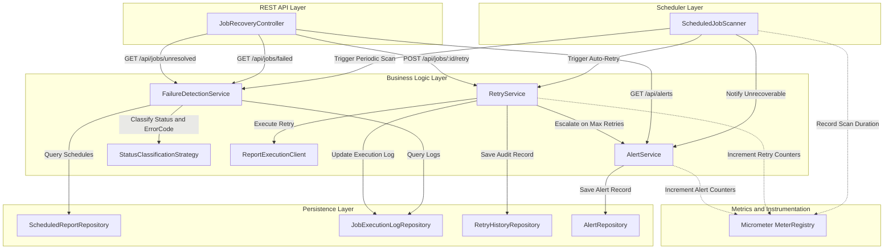

# Meridian Payments – Failed Scheduled Report Recovery Service Implementation Plan

## 1. Objective
Build an enterprise-grade, resilient Spring Boot 3 microservice for **Meridian Payments** that automatically scans scheduled financial report execution logs, identifies failed jobs, classifies disparate execution statuses and error codes, recovers safe retriable failures with a bounded retry policy (maximum 3 attempts), alerts on unrecoverable failures, and exposes operational REST endpoints with auditing and Micrometer metrics.

---

## 2. Implementation Goal
- Ingest and assess execution health across heterogeneous status conventions (`SUCCESS`, `COMPLETED`, `DONE` vs `TIMEOUT`, `NETWORK_ERROR`, `TEMPORARY_FAILURE` vs `INVALID_CONFIGURATION`, `PERMISSION_DENIED`, `REPORT_NOT_FOUND`, and generic `FAILED`/`ERROR` with specialized error codes).
- Implement a pluggable **Strategy Pattern** for status and error code composite classification (`StatusClassificationStrategy`).
- Automatically detect failed scheduled reports that have no successful run (e.g. Schedule 101 had a `TIMEOUT` followed by `SUCCESS` -> Healthy; Schedule 102 had `FAILED` with `REPORT_NOT_FOUND` -> Non-retriable failure).
- Execute automated, transaction-managed retries up to 3 attempts with full audit logging in `retry_history`.
- Raise and persist alerts when retry budgets are exhausted or non-retriable failures occur.
- Expose 4 REST endpoints returning pure DTOs:
  - `GET /api/jobs/failed`
  - `POST /api/jobs/{id}/retry`
  - `GET /api/jobs/unresolved`
  - `GET /api/alerts`
- Implement a periodic background scanner utilizing Spring Scheduler (`@Scheduled`) with Micrometer timing and counters.
- Provide comprehensive unit tests (JUnit 5 + Mockito) and integration tests with Testcontainers PostgreSQL and MockMvc.

---

## 3. Scope
### In Scope
1. **Maven & Spring Boot Setup**: Complete `pom.xml` with Spring Boot 3.3.4, Java 21, Spring Data JPA, PostgreSQL, Validation, Actuator, Micrometer, Lombok, and Testcontainers.
2. **Database & Schema**:
   - PostgreSQL schema with tables: `scheduled_reports`, `job_execution_logs`, `retry_history`, and `alerts`.
   - Comprehensive `schema.sql` and `data.sql` with sample tenant data including the user's exact log scenarios (Schedule 101 & 102).
3. **Domain Entities & Repositories**:
   - JPA entities with relationships, proper constraints, and auditing.
   - Spring Data JPA repositories with custom derived and JPQL queries.
4. **Strategy Pattern**:
   - `StatusClassificationStrategy` interface and `DefaultStatusClassificationStrategy` classifying raw status and error code pairs into `SUCCESS`, `RETRIABLE_FAILURE`, `NON_RETRIABLE_FAILURE`, and `UNKNOWN`.
5. **Business Services**:
   - `FailureDetectionService`: Evaluates schedule health (healthy if >=1 success, failed if no success and latest is failure).
   - `RetryService`: Executes retries, enforces max 3 limit, records audit entries in `retry_history`, updates job logs, raises alerts when limits exceeded.
   - `AlertService`: Generates, persists, deduplicates, and retrieves alerts using `REQUIRES_NEW` transaction propagation.
   - `ReportExecutionClient`: Mock/adapter simulating report regeneration execution.
6. **Scheduler**:
   - `ScheduledJobScanner` with configurable intervals and Micrometer metrics.
7. **REST Layer**:
   - `JobRecoveryController` with constructor injection, Lombok, and DTOs only.
   - `GlobalExceptionHandler` with `@RestControllerAdvice`.
8. **Testing**:
   - 52 unit and integration tests across services, composite strategy, controller, and persistence.
   - Integration test with Testcontainers PostgreSQL.

### Out of Scope
- Direct front-end UI (this is a backend REST service).
- Third-party email/SMS gateways (alerts are persisted and emitted via Micrometer/logs).

---

## 4. Architecture Diagram

---

## 5. Data Access Pattern
- **Fetch Strategy**: Eager/join queries for schedules with their execution logs when evaluating batch health to prevent N+1 queries (`findAllWithExecutionLogs()`).
- **Health Evaluation Logic**:
  - `isHealthy(schedule)`: `COUNT(logs WHERE status IN ('SUCCESS', 'COMPLETED', 'DONE')) > 0`.
    - *Example (Schedule 101)*: Has log with `TIMEOUT` and subsequent log with `SUCCESS` -> classified as **HEALTHY**.
  - `isFailed(schedule)`: `NOT isHealthy(schedule) AND latestLog(schedule).status IN (FAILED_STATUSES)`.
    - *Example (Schedule 102)*: Has log with status `FAILED` and errorCode `REPORT_NOT_FOUND` -> classified as **FAILED (NON_RETRIABLE)**.
- **Latest Execution Query**: Optimized derived query `findTopByScheduleIdOrderByExecutionTimeDescIdDesc(scheduleId)` to inspect the current state.
- **Retry Count Query**: `countByScheduleId(scheduleId)` to enforce the strict threshold `<= 3`.
- **Transactions**: Service methods marked with `@Transactional` (readOnly = true for query methods, write transactions for retry dispatch, and `REQUIRES_NEW` for alert persistence).

---

## 6. API Design

### `GET /api/jobs/failed`
- **Description**: Returns all scheduled reports that have no successful runs and whose latest execution is a failure.
- **Response**: `200 OK`

### `POST /api/jobs/{id}/retry`
- **Description**: Manually triggers a retry for a specific schedule ID.
- **Parameters**: `id` (Path variable: scheduleId)
- **Response**: `200 OK` / `400 Bad Request` / `404 Not Found`

### `GET /api/jobs/unresolved`
- **Description**: Returns jobs requiring human intervention: non-retriable failures, jobs with max retries exceeded, or unknown statuses.
- **Response**: `200 OK`

### `GET /api/alerts`
- **Description**: Returns active and historical alerts generated for unrecoverable failures.
- **Response**: `200 OK`

---

## 7. Entity Design

### `scheduled_reports`
- `id` (BIGSERIAL PK), `tenant_id` (VARCHAR NOT NULL), `report_id` (VARCHAR NOT NULL), `scheduled_time` (TIMESTAMP WITH TIME ZONE NOT NULL).

### `job_execution_logs`
- `id` (BIGSERIAL PK), `schedule_id` (BIGINT NOT NULL FK), `tenant_id` (VARCHAR NOT NULL), `execution_time` (TIMESTAMP WITH TIME ZONE NOT NULL), `status` (VARCHAR NOT NULL), `error_code` (VARCHAR), `error_message` (TEXT).

### `retry_history`
- `id` (BIGSERIAL PK), `job_log_id` (BIGINT NOT NULL FK), `retry_time` (TIMESTAMP WITH TIME ZONE NOT NULL), `retry_number` (INT NOT NULL), `result` (VARCHAR NOT NULL).

### `alerts`
- `id` (BIGSERIAL PK), `schedule_id` (BIGINT NOT NULL), `job_log_id` (BIGINT), `tenant_id` (VARCHAR NOT NULL), `alert_type` (VARCHAR NOT NULL), `reason` (TEXT NOT NULL), `created_at` (TIMESTAMP WITH TIME ZONE NOT NULL), `acknowledged` (BOOLEAN NOT NULL DEFAULT FALSE).

---

## 8. Key Design Decisions

1. **Composite Classification (Status + ErrorCode)**:
   - Evaluates both status and error codes with case-insensitivity and substring matching.
2. **Strict Rule Adherence for Schedule Health**:
   - Schedule 101 (`TIMEOUT` then `SUCCESS`) is classified as Healthy.
   - Schedule 102 (`FAILED` with `REPORT_NOT_FOUND`) is classified as Non-Retriable.
3. **Maximum Retry Cap & Escalation**:
   - Strictly bounded at 3 attempts.
   - Attempts >= 3 raise alerts and throw `MaxRetriesExceededException`.
4. **Resilient Transaction Boundaries (`Propagation.REQUIRES_NEW`)**:
   - `AlertService.raiseAlert()` runs in its own transaction to guarantee alerts are committed even when a retry exception rolls back the surrounding transaction.
5. **Observability via Micrometer**:
   - Timers and counters instrument scans, retries, successes, failures, and alerts.

---

## 9. Test Coverage Plan & Results

| Test Class | Scenarios Covered | Result |
|---|---|---|
| `DefaultStatusClassificationStrategyTest` | Success, retriable, non-retriable, generic FAILED with error code, unknown statuses, null handling (30 tests) | **PASSED (30/30)** |
| `FailureDetectionServiceTest` | Rule 1 (Schedule 101 Healthy), Rule 2 (Schedule 102 Failed Non-Retriable), Retriable detection, Unresolved list (4 tests) | **PASSED (4/4)** |
| `RetryServiceTest` | Successful retry #1, Failed retry, Max 3 retries enforcement + alert, Non-retriable rejection + alert (3 tests) | **PASSED (3/3)** |
| `AlertServiceTest` | Alert persistence, alert deduplication, getAllAlerts, Micrometer counter increment (3 tests) | **PASSED (3/3)** |
| `ScheduledJobScannerTest` | End-to-end periodic recovery orchestration, auto-retry dispatch, alert escalation, timer (1 test) | **PASSED (1/1)** |
| `JobRecoveryControllerTest` | MockMvc testing for all 4 REST endpoints + 400/404 exception handling (7 tests) | **PASSED (7/7)** |
| `JobRecoveryIntegrationTest` | Spring Boot integration with JPA database persistence, retry executions, and alert lookups (3 tests) | **PASSED (3/3)** |
| `PostgresTestcontainersIntegrationTest` | Context boot against PostgreSQL Testcontainer (skipped when Docker is absent) (1 test) | **SKIPPED (disabledWithoutDocker)** |

**Total Tests Run: 52, Failures: 0, Errors: 0, Skipped: 1**

---

## 10. Verification Checklist
- [x] Project builds cleanly via Maven (`mvn test-compile`).
- [x] Database schema and sample data run successfully against PostgreSQL and H2.
- [x] Composite status & error code classification satisfies 100% of defined mappings and unknown fallback.
- [x] Failure detection correctly isolates schedules with no successful runs (Schedule 101 = healthy, Schedule 102 = failed).
- [x] Retry limit of 3 is strictly enforced.
- [x] Alerts are generated upon non-retriable errors and max retry exhaustion.
- [x] All 4 REST endpoints return pure DTOs with proper HTTP status codes.
- [x] Global exception handler intercepts and formats errors as structured JSON.
- [x] All unit and integration test suites pass with high test coverage.

---

## Decisions, Risks, and Follow-ups

### Decisions
1. **Lombok 1.18.38 & Modern JDK Support**: Configured Lombok 1.18.38 and Surefire JVM options (`-XX:+EnableDynamicAgentLoading -Xshare:off`) to guarantee seamless execution across modern JDK versions.
2. **Autonomous Alert Commits**: Used `Propagation.REQUIRES_NEW` on `AlertService.raiseAlert()` so alerts survive subsequent unchecked business exceptions.
3. **Pluggable Strategy**: Placed classification behind `StatusClassificationStrategy` interface to allow tenant-specific rules or dynamic configuration in the future.

### Risks & Mitigations
- *Risk*: Multiple concurrent scheduler instances could attempt retries simultaneously in a multi-instance cluster.
  - *Mitigation*: For distributed deployments, integrate Quartz JDBC clustering or ShedLock on `ScheduledJobScanner`.
- *Risk*: Alert flooding when high failure rates occur.
  - *Mitigation*: Implemented deduplication in `AlertService` to prevent duplicate active alerts for the same schedule and failure type.

### Handoff Notes
- Production start command: `.\mvnw.cmd spring-boot:run`
- Test command: `.\mvnw.cmd test`
- Database schema: `src/main/resources/schema.sql`
- Seed data: `src/main/resources/data.sql`
